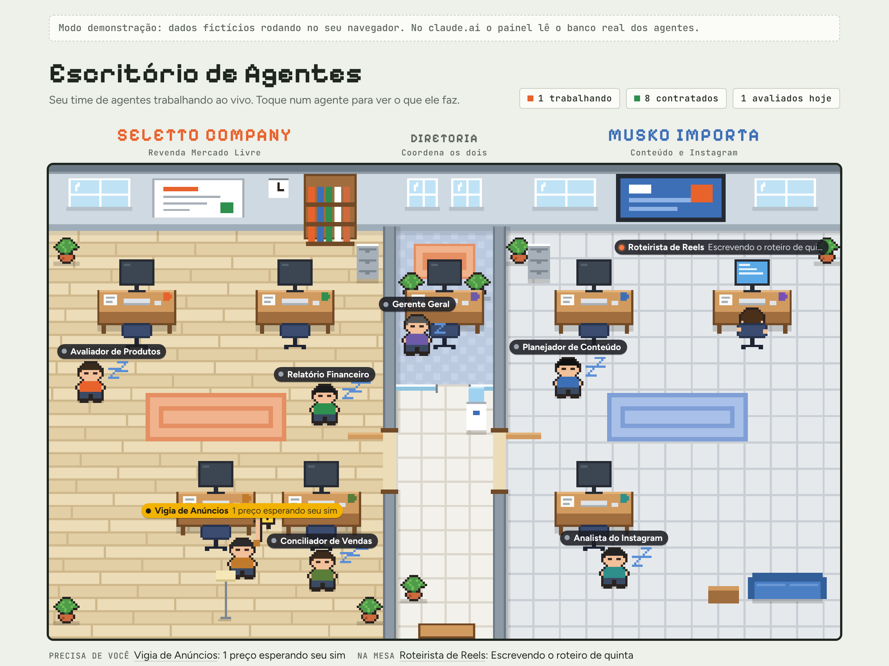
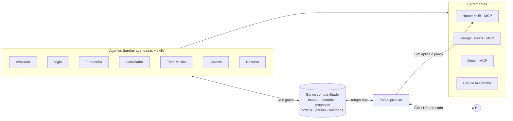

<div align="center">

# 🏢 Escritório de Agentes

**Um time de agentes de IA que opera dois negócios reais e aparece trabalhando num escritório em pixel art.**

[](https://github.com/mu-sko/escritorio-de-agentes/actions/workflows/validar.yml)


[**▶ Ver a demonstração ao vivo**](https://mu-sko.github.io/escritorio-de-agentes/) · [Arquitetura](docs/arquitetura.md) · [Agentes](agentes/) · [Decisões](docs/decisoes.md)



</div>

---

## O problema

Eu toco dois negócios à noite, depois do expediente:

- **Seletto Company**: revenda no Mercado Livre. Compro em promoção e revendo com margem. Exige avaliar ofertas, vigiar a concorrência de preço todo dia, conciliar vendas e fechar a semana.
- **Musko Importa**: perfil no Instagram que ensina a importar. Exige ler métricas, planejar a pauta e escrever roteiros toda semana.

Fazendo tudo à mão, eram horas de trabalho operacional por semana, e o que mais sofria era o que mais importava: decidir.

## A solução

Sete agentes de IA, cada um com **um papel, uma agenda e limites claros**, que trabalham sozinhos e só me chamam quando a decisão é minha. Um painel mostra o time como um escritório: quem está na mesa está trabalhando, quem anda com "zZ" está esperando e quem **levanta a mão** precisa de mim.

| Agente | O que faz | Quando |
|---|---|---|
| 🔍 **Avaliador de Produtos** | Audita uma oferta (catálogo, concorrência, Full, liquidez, ROI real) e devolve APROVADO / REPROVADO / PENDENTE com quantidade e capital | Sob demanda |
| 👁️ **Vigia de Anúncios** | Vê quem está ganhando o catálogo e propõe preço novo. **Aplica só com o meu Sim** | Todo dia 9h28 |
| 💰 **Relatório Financeiro** | Lucro, margem, ROI, capital parado e 3 ações da semana | Segunda 6h56 |
| 🧾 **Conciliador de Vendas** | Lança as vendas do ML na planilha por FIFO e confere com o payout | Segunda 7h50 |
| 🎬 **Time Musko** (3 em cadeia) | Métricas → pauta da semana → roteiros e legendas prontos | Domingo 17h52 |
| 🧠 **Gerente Geral** | Lê tudo o que o time fez, define 3 ações e dá o foco da semana a cada agente | Segunda 8h12 |
| 🛟 **Reserva** | Confere o que não rodou por falta de crédito e re-dispara | Segunda 22h37 |

Especificação completa de cada um em [`/agentes`](agentes/).

## Arquitetura



**Os agentes não conversam entre si: conversam pelo banco** (padrão *blackboard*). O Gerente lê o que os outros gravaram e responde com recados que eles leem na próxima rodada. Se um agente falha, os outros seguem, e o painel mostra tudo em tempo real. Detalhes em [`docs/arquitetura.md`](docs/arquitetura.md).

## Destaques técnicos

**🤝 Human-in-the-loop de verdade.** Ação com dinheiro (mudar preço) nunca é automática. O Vigia propõe, eu toco "Sim" no painel e a página chama o conector MCP direto: primeiro um *dry-run*, depois o `confirm`. Uma [máquina de estados](agentes/vigia-de-anuncios.md#máquina-de-estados-da-proposta) com `verificar` garante que um resultado incerto **nunca é reaplicado às cegas**.

**🔁 Idempotência e auto-recuperação.** Todo registro periódico tem `doc_id` derivado da data (`financeiro-20261020`). Rodar duas vezes não duplica, e "existe ou não existe" vira um teste de saúde de custo zero, usado pela Reserva para re-disparar só o que faltou.

**📬 Orquestração assíncrona.** Uma caixa de entrada por agente (`ordens`). Eu e o Gerente escrevemos, o agente lê, atende dentro das regras dele, responde e marca como feito. Em conflito, humano vence.

**🧮 Decisão com critério explícito.** O Avaliador é um pipeline eliminatório (filtros baratos antes dos caros) com uma matriz liquidez × ROI e uma regra própria de preço contra vendedores Full. **Dado não verificado nunca aprova.**

**💸 Custo como requisito.** O plano tem limite semanal, e isso moldou o desenho: três agentes numa só sessão, horários fora da hora cheia e notificação só quando há o que fazer. Os agentes que não se pagavam foram aposentados ([ADR-010](docs/decisoes.md#adr-010-enxugar-o-time)).

**🎮 Painel sem dependências.** HTML, CSS e JavaScript puro com Canvas 2D: pixel art com ordenação por profundidade, personagens que caminham até a mesa quando recebem tarefa, `onSnapshot` em tempo real, tema claro/escuro e botão para parar a animação. Cerca de 60 KB.

## Rodando o painel

O painel tem um **modo demonstração** com um banco em memória e dados fictícios, que imita a mesma API do banco real.

```bash
git clone https://github.com/mu-sko/escritorio-de-agentes.git
cd escritorio-de-agentes
npm run demo          # abre o painel em http://localhost:3000
```

Ou abra direto a [demonstração no GitHub Pages](https://mu-sko.github.io/escritorio-de-agentes/). No claude.ai, a mesma página detecta o runtime e passa a ler o banco real dos agentes.

```bash
npm install
npm run validar       # valida os exemplos contra os JSON Schemas e a sintaxe do painel
```

## Estrutura

```
escritorio-de-agentes/
├── painel/                  # interface: index.html, styles.css, app.js, demo-store.js
├── agentes/                 # especificação de cada agente (prompt sanitizado)
├── agentes.config.json      # registro declarativo: cadência, autonomia e prova de execução
├── schemas/                 # JSON Schema de cada coleção do banco
├── exemplos/                # documentos de exemplo, validados na CI
├── docs/
│   ├── arquitetura.md       # camadas, princípios e o painel por dentro
│   ├── modelo-de-dados.md   # coleções, convenções e diagrama ER
│   ├── decisoes.md          # ADRs e linha do tempo
│   ├── seguranca.md         # matriz de riscos e guardrails
│   └── roadmap.md
├── scripts/validar.mjs
└── .github/workflows/       # CI (validação) + deploy do painel no Pages
```

## O que eu aprendi

1. **O prompt é o código.** Guardrail escrito no prompt ("dado de bot nunca aprova", "nunca escreva na coluna AA") vale tanto quanto um `if`, e precisa ser versionado e revisado do mesmo jeito.
2. **Autonomia se dá por ação, não por agente.** O mesmo Vigia lê sozinho e pede permissão para escrever.
3. **Observabilidade vem antes de inteligência.** O painel e os `doc_id` previsíveis foram o que tornou possível confiar nos agentes.
4. **Agente que ninguém lê é custo, não automação.** Aposentar dois agentes melhorou o sistema.
5. **Entender o negócio vale mais que a tecnologia.** A regra do Full e a matriz liquidez × ROI vieram da operação real, não do modelo.

## Roadmap

- **v2**: estado em Supabase (Postgres) para consultas SQL, métricas de custo por agente e testes de regressão dos prompts
- **v3**: agentes reescritos com o Claude Agent SDK e cron próprio, com o `agentes.config.json` como fonte única

Detalhes em [`docs/roadmap.md`](docs/roadmap.md).

## Sobre

Feito por **Murilo Senhorini**, estudante de Engenharia de Software (UniFil), focado em IA aplicada a processos e agentes de IA.

[LinkedIn](https://www.linkedin.com/in/murilo-senhorini/) · [GitHub](https://github.com/mu-sko)

> Os números exibidos no modo demonstração e nos exemplos são fictícios. Identificadores reais (planilhas, contas, dispositivos) foram removidos deste repositório.
