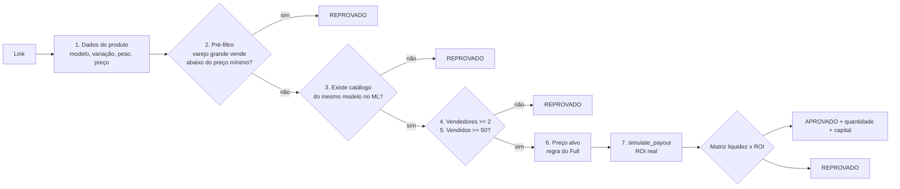

# Avaliador de Produtos

> Auditor de compra para revenda. Recebe **um** link de oferta e devolve `APROVADO`, `REPROVADO` ou `PENDENTE`, com números e o link de compra. Nunca compra, nunca altera anúncio.

| | |
|---|---|
| **Negócio** | Seletto Company (revenda no Mercado Livre) |
| **Gatilho** | Sob demanda: o humano manda o link num chat do projeto |
| **Implementação** | Skill do Claude (`analisador-produto-ml`) |
| **Ferramentas** | Claude in Chrome (lê a loja e o painel do Hunter Spy), Hunter HUB MCP (`get_market_catalog`, `list_catalog_items`, `simulate_payout`), Google Sheets (só leitura) |
| **Autonomia** | Total, porque só lê e calcula |

## Por que existe

Grupos de promoção soltam dezenas de ofertas por dia e os números dos bots (lucro, margem, vendas/dia) costumam vir errados. Decidir na mão leva de 10 a 15 minutos por oferta. O Avaliador faz a mesma auditoria em cerca de 1 minuto, sempre com o mesmo critério.

## Pipeline eliminatório

Cada passo pode encerrar a análise. Os filtros baratos vêm antes dos caros, para não gastar cota de API em produto que já morreu no pré-filtro.



### Regra do preço alvo (vendedor sem Full)

O comprador paga um pouco a mais para receber rápido pelo Full. Igualar o preço do Full não tira a venda dele, então:

- **Vencedor do catálogo é Full**: preço alvo = `min(menor_full × 0,90 ; menor_full − R$ 10)`
- **Vencedor sem Full, mas há Full no catálogo**: igualar o menor preço sem Full, desde que fique 10% e R$ 10 abaixo do Full
- **Sem Full no catálogo**: igualar o menor preço

### Matriz de decisão (liquidez é o inverso da margem)

| Vendas/dia | ROI | Veredito |
|---|---|---|
| ≥ 1 | ≥ 30% | APROVADO forte |
| ≥ 1 | 25% a 30% | APROVADO |
| ≥ 1 | < 25% | REPROVADO |
| < 1 | ≥ 100% | APROVADO (exceção) |
| < 1 | < 100% | REPROVADO |

### Dimensionamento da compra

```
qtd            = ceil(vendas_dia × 14 ÷ vendedores)      # 14 dias de giro
                 (vencedor Full: divide por vendedores + 1)
capital_parado = qtd × custo
dias_pra_girar = qtd ÷ (vendas_dia ÷ vendedores)
```

## Guardrails

- **Dado não verificado nunca aprova.** Se o veredito depende de dado do bot, print ou planilha sem confirmação no ML de hoje, sai `PENDENTE`. Pode reprovar com dado não verificado, mas nunca aprovar.
- Sem dado é "sem dado": proibido estimar número.
- Captcha no Mercado Livre: não tenta resolver, sai `PENDENTE`.
- Ofertas que dependem de contas falsas ou de burlar limite de cupom ficam fora de escopo (risco de banir as contas boas).
- **Possível erro de preço** (3× abaixo do mercado): responde rápido, com risco de cancelamento e no máximo 1 a 2 unidades.

## Fonte reserva

Quando o Hunter falha ou estoura a cota, usa a planilha de compras e vendas (histórico real: preço de venda, taxa, frete e giro). Veredito apoiado só na planilha sai `PENDENTE`.

## Saída

Texto simples para o celular, mais um evento JSON para o painel:

```text
APROVADO: Garrafa térmica 1,2 L
Comprar: https://loja.exemplo/produto
• Compra: R$ 59,90 | Venda alvo: R$ 119,90
• Preço mín. venda: R$ 96,40 | Folga: R$ 23,50
• Líquido: R$ 82,70 | ROI: 38%
• Vendidos: 3.200 | Vendas/dia: 4 | Vendedores: 6
• Vencedor do catálogo: R$ 121,90 (sem Full)
• Qtd: 10 | Capital: R$ 599 | Giro: 15 dias
• Fonte dos números: Hunter
• Motivo: giro alto e ROI acima do alvo
```

```json
{"agente":"avaliador","ts":"2026-10-22T13:00:00Z","produto":"Garrafa térmica 1,2 L","veredito":"aprovado","roi":38,"vendas_dia":4,"capital":599,"vencedor_full":false,"fonte":"chrome"}
```

*(Exemplo com números fictícios.)*
