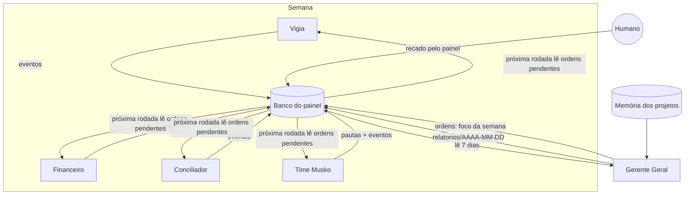

# Gerente Geral

> O maestro. Lê tudo que o time registrou na semana, decide onde pôr tempo e dinheiro e **dá a cada agente o foco da semana**. Recomenda; nunca executa.

| | |
|---|---|
| **Negócio** | Seletto e Musko |
| **Gatilho** | Toda segunda 8h12, depois do Financeiro (6h56) e do Conciliador (7h50) |
| **Ferramentas** | Banco do painel (`eventos`, `estado`, `propostas`, `pautas`, `ordens`), memória dos projetos |
| **Autonomia** | Escreve relatório e recados. Nunca compra, muda preço, publica ou mexe em tarefa agendada. |

## Padrão de orquestração: supervisor assíncrono

O Gerente não chama os outros agentes. Ele **lê o que eles gravaram** e **escreve recados** que eles leem na próxima execução. É um supervisor desacoplado por um quadro de mensagens (o padrão *blackboard*):



**Vantagens**: nenhum agente depende de outro estar online; uma falha não derruba a cadeia; tudo fica auditável no painel; e o humano pode desfazer qualquer foco respondendo no mesmo canal. **Conflito**: recado do humano vence recado do Gerente.

## O que faz

1. **Lê a semana**: eventos dos últimos 7 dias, estado de cada agente, propostas paradas, a última pauta, recados não lidos e a memória dos dois projetos.
2. **Detecta agente parado**: compara a cadência esperada (Vigia diário; Time Musko aos domingos; Financeiro e Conciliador às segundas) com o último registro. Só alerta: nunca dispara tarefa.
3. **Analisa**: o que rendeu, o que está acontecendo, melhorias e **exatamente 3 ações** em ordem de impacto, com peso maior para o negócio prioritário.
4. **Dá foco**: um recado curto e concreto para cada agente que precisa de ajuste (ex.: *"Vigia: não baixe preço de colecionável abaixo de ROI 30%"*). Recado que quebre a regra do agente (comprar, publicar, mudar preço sem o Sim) é proibido.
5. **Publica o relatório** em `relatorios/<AAAA-MM-DD>`, que o painel mostra na seção "Semana do Gerente".

## Saída

```text
GERENTE GERAL
Semana 13/10 a 19/10: Seletto estável, Musko ganhando tração
1. Recomprar a garrafa térmica (ROI 38%, giro de 4 dias)
2. Gravar os 2 Reels da pauta até quinta
3. Liquidar os 2 encalhados há 40+ dias
Precisa de você: 1 preço esperando o Sim
Detalhes no painel.
```
