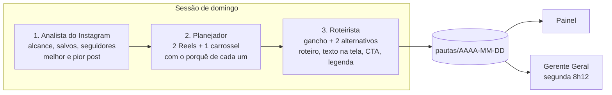

# Time Musko: Analista do Instagram → Planejador de Conteúdo → Roteirista de Reels

> Três agentes que rodam em **cadeia numa única sessão**: o resultado de um vira a entrada do próximo. Entregam a pauta da semana com roteiros e legendas prontos para gravar. **Nunca publicam.**

| | |
|---|---|
| **Negócio** | Musko Importa (perfil de Instagram que ensina importação) |
| **Gatilho** | Todo domingo 17h52 |
| **Ferramentas** | Claude in Chrome (Meta Business Suite, painel de afiliado, YouTube, Discord só leitura), Supermetrics (fallback de métricas), memória do projeto |
| **Autonomia** | Total para rascunho. Publicar, comentar e mandar mensagem ficam com o humano. |

## Por que uma sessão só, e não três tarefas

Os três precisam do mesmo contexto (as métricas da semana). Separados, cada um teria que reler tudo, o que custa 3× mais tokens e cria o risco de o Roteirista rodar antes do Planejador. Em cadeia, o contexto passa de mão em mão e o painel ainda mostra **três mesas**: o agente atualiza `estado/metricas`, `estado/pauteiro` e `estado/roteirista` conforme muda de etapa.



## Etapa 1: Analista do Instagram

- Alcance, visualizações, salvos, compartilhamentos e seguidores ganhos (Meta Business Suite).
- Melhor e pior post da semana, com o porquê: gancho, tema ou formato.
- Usuários ativos no programa de afiliado (métrica de negócio, não de vaidade).
- **Sem dado = diz que não tem.** Nunca inventa número.

## Etapa 2: Planejador de Conteúdo

**Insumos**: o relatório da etapa 1, as dúvidas que mais aparecem na comunidade, o que criadores de referência postaram e o banco de ganchos na memória do projeto.

**Fórmula validada na conta**: tensão no 1º segundo (segredo, vilão, hype) + produto de desejo + conta China × Brasil em R$ + CTA "Comenta PALAVRA".

**Entrega**: 2 Reels (terça e quinta) + 1 carrossel (sábado), dizendo se cada um dá para fazer **sem gravar** (motion graphics) ou se precisa de rosto. Também 5 a 7 ideias de stories e, no 1º domingo do mês, uma revisão do perfil.

## Etapa 3: Roteirista de Reels

- Reel de até 45s: gancho dos 3 primeiros segundos (mais 2 alternativos), fala em frases curtas, texto na tela, cortes e CTA "Comenta PALAVRA" com a palavra a cadastrar no ManyChat.
- Carrossel de 5 a 7 cards: capa com promessa forte, uma ideia por card, CTA no último.
- Legenda com gancho na 1ª linha e 5 a 8 hashtags de nicho.

## Guardrails

- Nicho fechado: ensinar importação e achados. Nada de réplica nem de "jeitinho" na alfândega.
- Produto de marca é enquadrado como "achado" ou "alternativa", nunca "réplica".
- Comunidade no Discord: **só leitura**. Nunca escreve nem reage pela conta do humano.
- Usa o perfil do Chrome **da conta do Musko**, nunca o da conta pessoal (isolamento entre negócios).

## Saída

Documento estruturado em `pautas/<domingo>` (ver [schema](../schemas/pauta.schema.json)) que o painel renderiza com botão "Copiar legenda", mais o evento `pauta-<AAAAMMDD>` e a notificação:

```text
TIME MUSKO
Semana: 18,4 mil de alcance, +212 seguidores. Melhor post: taxa explicada em 30s
Terça (Reel): A taxa de 20% na prática
Quinta (Reel): 3 erros do primeiro pedido
Sábado (carrossel): Agente de compra em 5 passos
Roteiros e legendas prontos no painel.
```
