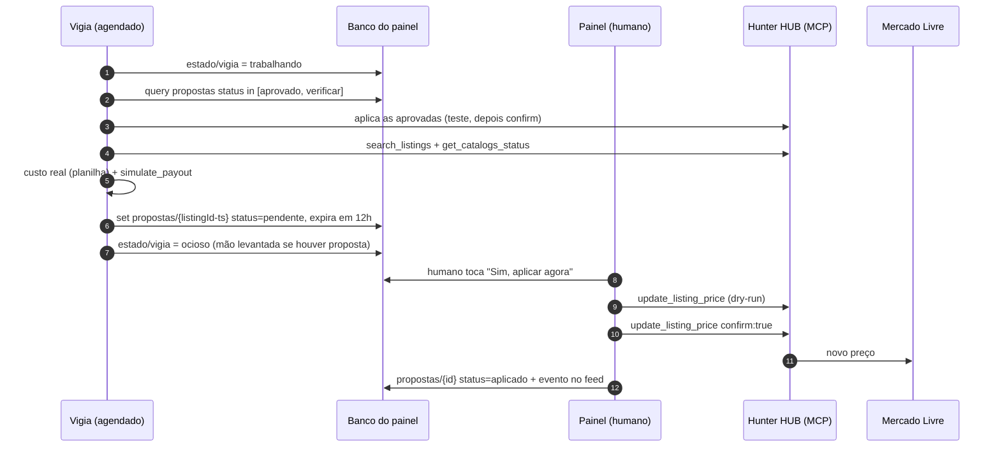
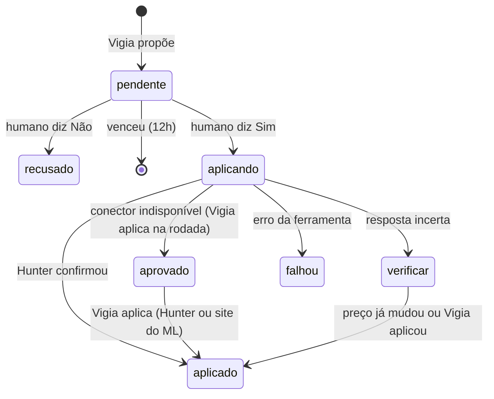

# Vigia de Anúncios

> Protege a margem dos anúncios. Vê quem está ganhando ou perdendo o catálogo, propõe preço novo no painel e **só aplica com o Sim humano**.

| | |
|---|---|
| **Negócio** | Seletto Company |
| **Gatilho** | Tarefa agendada, todo dia 9h28 (America/Sao_Paulo) |
| **Ferramentas** | Hunter HUB MCP (`search_listings`, `get_catalogs_status`, `simulate_payout`, `update_listing_price`), Google Sheets (custo real), Claude in Chrome (fallback pelo site do ML) |
| **Autonomia** | Propõe sozinho. Mudança de preço exige aprovação humana. |

## Fluxo



## Regras de preço

- **Baixar** (perdendo o catálogo): o preço que volta a ganhar, até o **piso de ROI 25% sobre o custo** (15% se o anúncio está parado há mais de 30 dias). Abaixo do piso, não propõe: só cita no resumo.
- **Subir** (ganhando com folga, ou o concorrente sumiu/subiu): logo abaixo do próximo concorrente, mantendo o catálogo.
- **Recompra**: estoque baixo + bom giro + produto em promoção no varejo vira um evento `recompra`, sem proposta de preço.
- Não duplica: se já existe proposta pendente para o mesmo `listingId`, não cria outra.

## Guardrails (o mais importante deste agente)

| Risco | Mitigação |
|---|---|
| Agente muda preço errado | Nunca muda sem o Sim. A proposta vence em 12h. |
| Clique duplo aplica duas vezes | O botão desabilita na hora. Estado `aplicando` antes da chamada. |
| Timeout: não sabe se aplicou | Estado `verificar`. Na próxima rodada o Vigia **confere o preço atual antes** de tentar de novo. Nunca repete às cegas. |
| Hunter sem permissão ou fora do ar | Marca `aprovado` e o Vigia aplica pelo site do ML no Chrome. |
| Erro de chamada antes de aplicar | Primeiro chama sem `confirm` (dry-run). Só depois `confirm: true`. |

### Máquina de estados da proposta



## Saída

Notificação (só quando há proposta nova, preço aplicado, recompra ou problema):

```text
VIGIA DE ANÚNCIOS
1 proposta esperando seu Sim no painel (vence em 12h)
▼ Caixa de som Z: R$ 249,90 → R$ 236,90 | ROI 27%
Aplicado: Fone X1 R$ 189,90 → R$ 179,90
```
