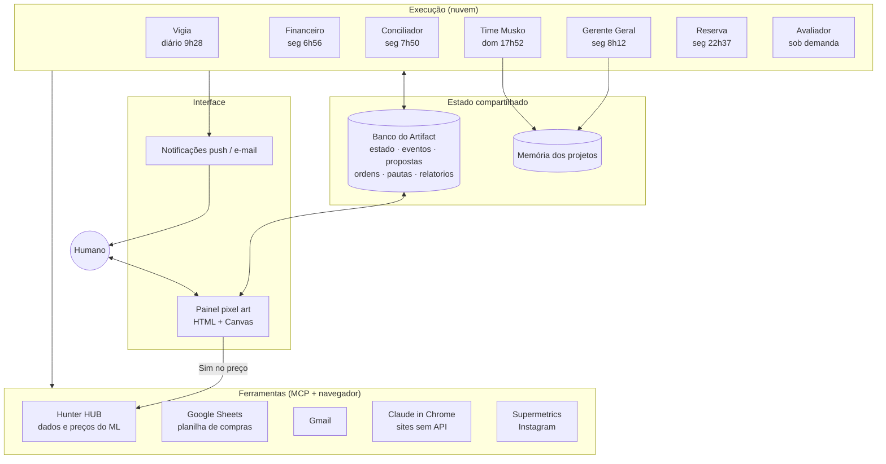

# Arquitetura

## Visão geral

O sistema tem três camadas desacopladas por um **banco de documentos compartilhado**:

| Camada | Tecnologia | Responsabilidade |
|---|---|---|
| **Execução** | Tarefas agendadas do Claude (cron com fuso), cada uma com um prompt de sistema; skills para lógica reutilizável | Raciocínio, chamadas de ferramenta, decisões dentro do escopo |
| **Ferramentas** | Conectores MCP (Hunter HUB, Google Sheets, Gmail, Supermetrics) e Claude in Chrome para sites sem API | Ler e escrever no mundo |
| **Estado** | Banco de documentos do Artifact (coleções no estilo Firestore, com `onSnapshot`) | Fonte da verdade, fila de mensagens e trilha de auditoria |
| **Interface** | Página HTML + Canvas 2D, sem framework e sem build | Visualização ao vivo, aprovação humana e recados |

## Princípios de design

### 1. Agentes não conversam entre si: conversam pelo banco

Nenhum agente chama outro. Todos leem e escrevem no mesmo banco (padrão *blackboard*). Isso dá:

- **Tolerância a falhas**: se o Financeiro não rodar, o Gerente segue com o que tem e diz o que faltou.
- **Auditoria**: todo passo relevante vira um documento com timestamp.
- **Interface de graça**: o painel só "assina" as coleções e redesenha.

### 2. Autonomia proporcional ao risco

| Ação | Quem decide |
|---|---|
| Ler, pesquisar, calcular, gerar rascunho | Agente, sozinho |
| Escrever na planilha (colunas travadas) | Agente, com escopo restrito |
| **Mudar preço, comprar, publicar, mandar mensagem** | **Humano**, com um toque no painel |
| Criar, editar ou apagar tarefa agendada | Ninguém automaticamente |

### 3. Idempotência por chave determinística

Todo registro periódico usa `doc_id` derivado da data (`financeiro-20261020`, `pautas/2026-10-19`). Rodar duas vezes sobrescreve em vez de duplicar, e "existe ou não existe" vira um teste barato de saúde, que a Reserva usa para saber o que re-disparar.

### 4. Na dúvida, não repete

Ações com efeito externo (mudar preço) têm um estado `verificar` para resultado incerto. O agente **confere o mundo antes de agir de novo**. Isso evita o pior bug possível aqui: baixar o preço duas vezes.

### 5. Custo como requisito

O plano tem limite semanal de uso, e o sistema foi desenhado em torno disso:

- Horários fora do minuto 00 (evita a fila da hora cheia).
- Time Musko em **uma sessão** com três etapas, em vez de três sessões relendo o mesmo contexto.
- Filtros baratos antes dos caros no Avaliador (pré-filtro no varejo antes de gastar cota do Hunter).
- Notificação só quando há algo acionável.
- Agentes que não pagavam o custo foram aposentados (ver [decisões](decisoes.md)).

### 6. Isolamento entre negócios

Cada negócio usa um perfil de navegador com a sua própria conta. O prompt fixa qual perfil usar e proíbe perguntar ou trocar. Assim, um agente da Musko nunca age logado na conta da Seletto, e vice-versa.

## Painel: como funciona por dentro

- **Canvas 2D em pixel art** (360×216 px lógicos, escala 4×). O fundo é pré-renderizado num canvas fora da tela, e só personagens e móveis são redesenhados por quadro, ordenados por profundidade (y).
- **Máquina de estados visual por agente**: `trabalhando` (sentado, tela acesa, digitando) → `ocioso` (anda pela sala com zZ) → `mão levantada` (precisa do humano, com "!" pulando). As transições são animadas: o personagem caminha até a cadeira ao receber uma tarefa.
- **Estado é derivado, não armazenado**: `estadoDe(agente)` combina `estado/<id>`, a idade do registro (mais de 45 min sem atualização vira ocioso, protegendo contra agente que morreu no meio) e as propostas pendentes.
- **Tempo real**: `onSnapshot` em cada coleção, sem polling.
- **Acessibilidade**: botão para parar o movimento (preferência salva no navegador), etiquetas de nome como `<button>` com `aria-label`, diálogo nativo `<dialog>` e tema claro/escuro.
- **Modo demonstração**: fora do claude.ai, o painel usa o [`demo-store.js`](../painel/demo-store.js), um banco em memória com a mesma API, então dá para ver tudo funcionando no GitHub Pages.
