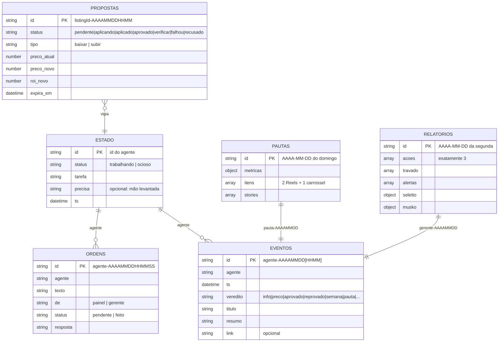

# Modelo de dados

Banco de documentos com seis coleções. Leitura liberada a quem vê o painel; escrita só do dono (os agentes rodam com a identidade dele). Schemas formais em [`/schemas`](../schemas).

## Coleções

| Coleção | Quem escreve | Quem lê | Papel |
|---|---|---|---|
| `estado` | cada agente (a própria mesa) | painel, Gerente | O que cada agente está fazendo agora |
| `eventos` | todos os agentes; painel (preço aplicado) | painel, Gerente, Reserva | Feed e trilha de auditoria |
| `propostas` | Vigia (cria); painel (decide); Vigia (aplica) | painel, Vigia, Gerente | Fila de aprovação humana |
| `ordens` | humano pelo painel; Gerente | agente destinatário | Recados assíncronos (caixa de entrada por agente) |
| `pautas` | Time Musko | painel, Gerente, Reserva | Conteúdo da semana |
| `relatorios` | Gerente | painel, Reserva | Visão semanal consolidada |

## Convenções

- **Datas**: sempre ISO 8601 em UTC no campo `ts`. Datas "de negócio" no `doc_id` usam o fuso de São Paulo, porque a semana do humano é a semana local.
- **IDs determinísticos** para tudo que é periódico: garantem idempotência e permitem checar se algo rodou com um `get`.
- **Escrita condicional**: agentes fazem `get` e depois `set` com `if_version` no próprio estado, para não sobrescrever uma mudança concorrente.
- **Nada sensível no banco**: custos e IDs de anúncio, sim; credenciais, nunca.
